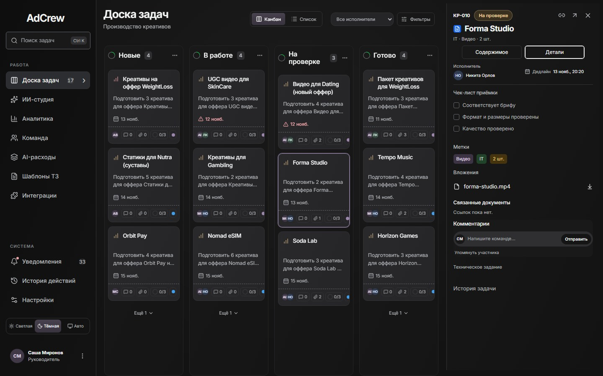
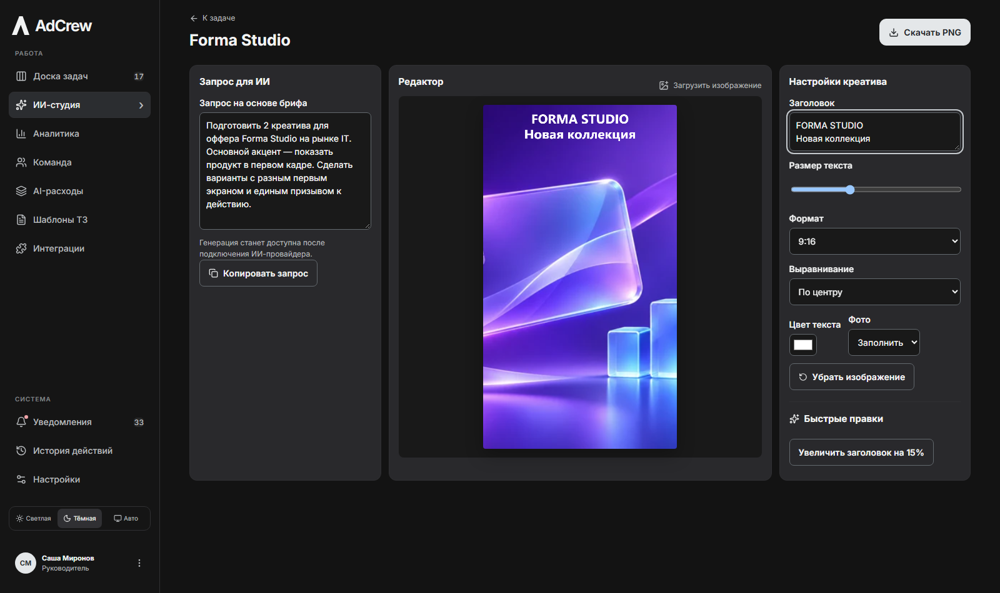
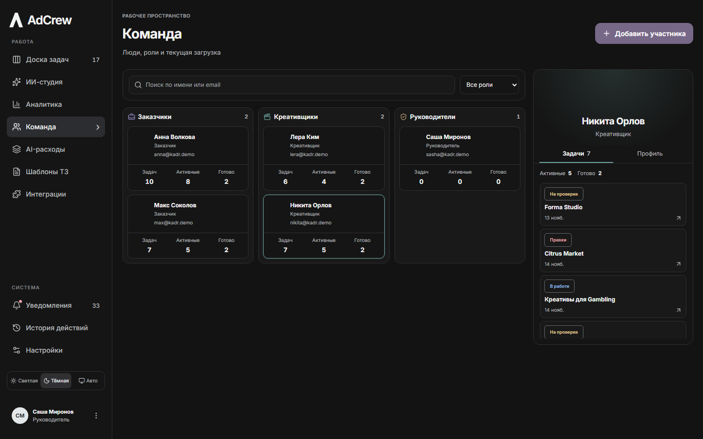
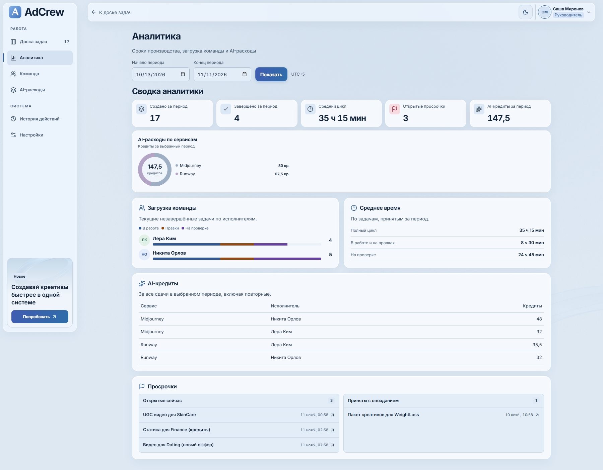

<div align="center">
  
  <h1>AdCrew</h1>
  <p><strong>Креативное производство под контролем.</strong></p>
  <p>Рабочее пространство для рекламных задач — от первого ТЗ до принятого креатива.</p>
  <p><a href="https://httpeacex.github.io/adcrew/"><strong>Открыть интерактивное демо ↗</strong></a></p>
  <p>
    <a href="https://httpeacex.github.io/adcrew/"></a>
    
    
    <a href="https://github.com/httpeacex/adcrew/actions/workflows/pages.yml"></a>
  </p>
</div>

[](https://httpeacex.github.io/adcrew/)

## Главная и вход

По ссылке открывается главная AdCrew с галереей рекламных креативов. Кнопки «Войти» и «Открыть доску» открывают форму входа поверх страницы. «Тестовый вход» открывает выбор роли. Переключатель темы расположен слева внизу. Стеклянная рамка и фон адаптируются к теме, карточки галереи поднимаются и выравниваются при наведении.


## От идеи до готового креатива

AdCrew объединяет покупателей рекламы, креативщиков и руководителя. В карточке задачи сохраняются бриф, файлы, версии и решения по каждому раунду согласования.

**Новые → В работе → На проверке → Готово**

Если нужны изменения, байер возвращает задачу на правки. Креативщик сдаёт новую версию, а замечания к предыдущей остаются в карточке.



| Возможность | Что внутри |
| --- | --- |
| **Доска задач** | Четыре колонки по умолчанию, все статусы через фильтры, поиск по названию и ID, панель задачи справа |
| **Техническое задание** | Оффер, формат, количество, дедлайн в UTC+5, описание и референсы |
| **Сдача и правки** | Несколько версий, комментарии, предпросмотр и скачивание PNG, JPEG, WebP и MP4 |
| **Уведомления и история** | Упоминания и обновления с переходом к задаче, журнал изменений |
| **ИИ-студия** | Открытие из взятой задачи, черновик запроса по брифу, редактор изображений и экспорт PNG |
| **AI-расходы** | Учёт кредитов по сервисам, исполнителям и каждому раунду работы |
| **Аналитика** | Загрузка команды, время производства и проверки, открытые и закрытые просрочки |
| **Удобство** | Две темы, адаптивный интерфейс, сохранение фильтров, клавиатурная навигация и плавные панели |

[Концепция продукта, структура, UX и предложения по развитию](docs/product-concept.md).

## Попробовать

Откройте **[httpeacex.github.io/adcrew](https://httpeacex.github.io/adcrew/)** и нажмите **«Тестовый вход»**.

| Роль | Возможности |
| --- | --- |
| Покупатель | Создаёт ТЗ, отправляет на правки и принимает результат |
| Креативщик | Берёт задачи, загружает файлы и указывает расход AI-кредитов |
| Руководитель | Видит задачи отдела, аналитику, команду и историю действий |

В меню учётной записи можно переключаться между пятью демопользователями. Для знакомства уже подготовлены 17 задач, примеры креативов, сдач и правок.

Демо на GitHub Pages сохраняет задачи, файлы и версии в **IndexedDB вашего браузера**. Данные сохраняются после перезагрузки и доступны вкладкам этого браузера. Роль выбирается отдельно в каждой вкладке. Другие устройства используют свои данные; очистка данных сайта удаляет локальные изменения.

## ИИ-студия

В левом меню выберите «ИИ-студия» или откройте свою задачу кнопкой «Открыть в студии». Студия подставит название и бриф. Загрузите изображение, выберите формат 9:16, 1:1 или 16:9, настройте текст и скачайте PNG. Файл можно прикрепить через обычную сдачу результата.

Черновик запроса можно скопировать для внешнего ИИ-сервиса. Для генерации внутри студии потребуется подключить провайдера.

Telegram, Google Drive и Slack показаны в разделе «Интеграции» как запланированные подключения.



## Команда



## Аналитика в светлой теме



## Локальный запуск

Понадобится **Node.js 24+**.

```sh
git clone https://github.com/httpeacex/adcrew.git
cd adcrew
npm ci
npm run dev
```

Серверная версия откроется на **[localhost:3000](http://localhost:3000)**. Она использует Next.js и SQLite: сессии, доступ к задачам и файлам проверяются на сервере, база хранится в `.data/kadr.sqlite`.

Чтобы запустить именно браузерное демо:

```sh
npm run build:pages
npm run preview:pages
```

Откройте **[localhost:4173/adcrew/](http://localhost:4173/adcrew/)**. Вход по почте также доступен: `anna@kadr.demo`, `lera@kadr.demo` или `sasha@kadr.demo`, пароль `Kadr-Demo-2026!`.

## Устройство проекта

| Часть | Технологии |
| --- | --- |
| Интерфейс | React 19, TypeScript, Lucide, локальные шрифты Inter |
| Серверная версия | Next.js 16, SQLite из Node.js, серверные сессии |
| Демо на Pages | Vite, SQLite WebAssembly, IndexedDB, маршруты в URL после `#` |
| Общая логика | Одни компоненты, правила ролей, статусы, версии и расчёт аналитики для обеих сборок |
| Проверки | Node.js Test Runner, Playwright, ESLint и TypeScript |
| Публикация | GitHub Actions → GitHub Pages при обновлении `main` |

### Настройки серверной версии

| Переменная | Назначение |
| --- | --- |
| `KADR_DB_PATH` | Путь к SQLite; по умолчанию `.data/kadr.sqlite` |
| `KADR_DEMO_MODE` | `0` отключает демонаполнение и быстрый вход; требуется заранее подготовленная база |
| `KADR_DEMO_PASSWORD` | Пароль демопользователей при создании новой базы |
| `KADR_SECURE_COOKIE` | `1` для серверного размещения за HTTPS |

Серверной версии нужен Node.js-хост с постоянным диском. GitHub Pages публикует браузерное демо; его сборка всегда создаёт свежие синтетические данные и не использует рабочую базу или сессии.

### Проверки

```sh
npm run lint
npm run typecheck
npm test
npm run build
npx playwright install chromium --only-shell
npm run test:e2e
npm run build:pages
npm run test:pages
```

Проверки проходят создание ТЗ, конкурирующее взятие задачи, две сдачи с правками, скачивание файлов, роли, AI-кредиты, мобильную карточку и сохранение данных после перезагрузки.

---

<sub>Изображения креативов и иллюстрации интерфейса созданы с помощью ImageGen. Шрифт Inter распространяется по OFL; текст лицензии находится в <code>public/fonts/Inter-OFL.txt</code>.</sub>
